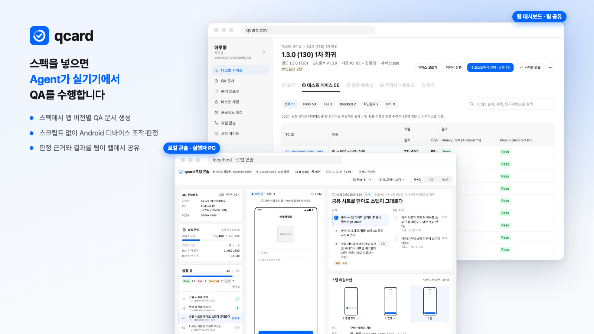

# qcard

[](https://github.com/JaesungLeee/qcard/actions/workflows/deploy.yml)
[](https://www.npmjs.com/package/@qcard/host)
[](LICENSE)

<picture>
  <source media="(prefers-color-scheme: dark)" srcset="docs/images/hero-dark.png">
  
</picture>

스펙 문서를 넣으면 AI Agent가 **앱 버전별 QA 문서(테스트 케이스)를 만들고**, 실행자 PC에 연결된 **Android 디바이스에서 직접 수행**하는 QA 자동화 플랫폼이다. 실행자는 로컬 콘솔에서 디바이스 화면과 Agent의 판단을 실시간으로 지켜보고, 팀은 웹 대시보드에서 진행 상태와 결과를 함께 본다.

서비스: [qcard.dev](https://qcard.dev) · 호스트 에이전트: npm [`@qcard/host`](https://www.npmjs.com/package/@qcard/host)

## 왜 만들었나

- QA 시트 작성은 문서를 읽고 케이스를 손으로 풀어내는 반복 작업이고, 작성자에 따라 커버리지가 달라진다.
- 스크립트 기반 모바일 자동화(Appium 등)는 작성·유지보수 비용이 크고, 화면이 바뀌면 깨진다.
- 자동화가 돌아도 "왜 Pass인지" 사람이 확인하기 어려워 결과를 믿기 어렵다.
- 결과가 개인 PC와 시트에 흩어져 팀이 함께 추적하기 어렵다.

## 어떻게 동작하나

1. **스펙 업로드** — 앱 버전마다 스펙 폴더(`docs/specs/<기능>/spec.md`)를 통째로 올린다.
2. **QA 문서 생성** — 스펙의 테스트 시나리오·엣지 케이스 표의 행을 실행할 수 있는 케이스로 바꾼다. 이전 버전과 출처 ID로 매칭해, 바뀌지 않은 케이스는 사람의 수정·승인을 그대로 이어받는다. 사람이 웹에서 검토·편집·승인한다.
3. **테스트 사이클** — QA 문서 버전 + 빌드(APK) + 대상 디바이스로 사이클을 만든다.
4. **실행** — 각 실행자가 자기 PC의 호스트 에이전트로 Run을 시작한다. Agent가 스크립트 없이 화면을 보고 조작하며, 검증 포인트마다 증거를 남긴다. 위험한 액션이나 본인인증은 사람에게 넘긴다.
5. **결과** — 조건을 모두 채운 Pass는 자동 확정되고, 나머지는 사람이 판정 추적 화면에서 근거를 따라가 확정한다. 웹 QA 시트로 팀이 같은 결과를 본다.

LLM은 **각 사용자 PC에 설치된 본인의 Claude Code**로 부른다. 비용은 각자의 Claude 구독 플랜에서 차감되고, qcard는 Claude 자격 증명을 다루지 않는다.

## 범위

- Android만 지원한다(iOS는 이후). 호스트 에이전트는 macOS만 지원한다.
- 웹·데스크톱 앱 테스트, 성능·보안 테스트, 픽셀 단위 시각 회귀, 원격 실행은 범위 밖이다.

## 문서

| 문서                                         | 내용                                                                                                                                                                                                                                                                                                                   |
| -------------------------------------------- | ---------------------------------------------------------------------------------------------------------------------------------------------------------------------------------------------------------------------------------------------------------------------------------------------------------------------- |
| [docs/concepts.md](docs/concepts.md)         | 용어, 판정, 데이터 모델                                                                                                                                                                                                                                                                                                |
| [docs/architecture.md](docs/architecture.md) | 구성 요소, Agent 구조, 기술 스택, 테스트 전략                                                                                                                                                                                                                                                                          |
| [docs/product/](docs/product/)               | 기능별 동작 규칙 — [QA 문서](docs/product/qa-doc.md) · [준비 플로우·테스트 계정](docs/product/prep-flows.md) · [사이클](docs/product/cycles.md) · [Agent 실행](docs/product/execution.md) · [로컬 콘솔](docs/product/console.md) · [결과·QA 시트](docs/product/results.md) · [프로젝트·멤버](docs/product/projects.md) |
| [docs/security.md](docs/security.md)         | 데이터 전송·권한·비밀값·삭제                                                                                                                                                                                                                                                                                           |
| [docs/spec-format.md](docs/spec-format.md)   | qcard가 읽는 `spec.md` 형식                                                                                                                                                                                                                                                                                            |
| [docs/decisions.md](docs/decisions.md)       | 주요 결정과 이유                                                                                                                                                                                                                                                                                                       |
| [docs/roadmap.md](docs/roadmap.md)           | 지금 상태, 다음 할 일, 미룬 것                                                                                                                                                                                                                                                                                         |
| [docs/dev/](docs/dev/)                       | 개발 명령 — 호스트 에이전트, 실기기·LLM, 에뮬레이터, 배포, CI, 브랜치                                                                                                                                                                                                                                                  |
| [CLAUDE.md](CLAUDE.md)                       | 저장소 구조와 개발 규칙                                                                                                                                                                                                                                                                                                |

## 개발

```sh
pnpm install          # pnpm이 없으면 npx -y pnpm@10.34.6 install
pnpm verify           # 타입 검사 + 테스트 + 색 하드코딩 검사
pnpm dev              # http://localhost:5173 (메모리 구현), /__ui 에서 UI 카탈로그
pnpm ui:snap          # 화면 스크린샷 (처음 한 번: pnpm --filter @qcard/web exec playwright install chromium)
```

`pnpm verify`는 실기기·실제 LLM 없이 돈다(Fake 디바이스, 녹화 재생, Firebase 에뮬레이터 — 에뮬레이터 테스트에 Java 21 이상 필요). 브랜치는 `develop`에서 딴 `feature/<이름>`으로 작업한다([docs/dev/branching.md](docs/dev/branching.md)).
